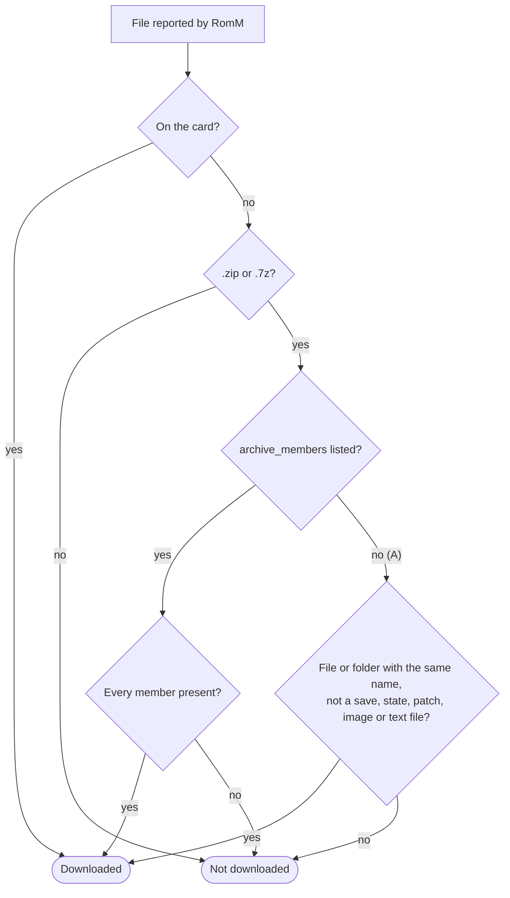

---
search:
  exclude: true
---

# ADR 0001: Detect extracted ROMs as downloaded

- **Status:** Proposed
- **Date:** 2026-10-10
- **Issue:** [#233](https://github.com/rommapp/grout/issues/233)

## Context

Grout keeps no record of what it downloaded. To mark a game as downloaded, it checks
whether the exact file name RomM reports exists in the platform's ROM directory
(`cfw/downloads.go`). Unpacking a download changes that name, so the game is no longer
recognised.

**Single-file ROM with "Unzip Downloads" on.** The archive is deleted after unpacking:

```
RomM reports   roms/gba/Game.zip     ← grout looks for this
On the card    roms/gba/Game.gba     (Game.zip removed after unpacking)
```

**Multi-file ROM (`has_multiple_files`).** It is unpacked into a folder, but grout looks
for a playlist at the root. Only muOS moves the `.m3u` up, and only when the archive has
one. The folder is `_<name>/` on muOS.

```
Grout looks for   roms/psx/Final Fantasy IX.m3u
On the card       roms/psx/Final Fantasy IX/
                  ├── FF9 (Disc 1).chd
                  ├── FF9 (Disc 2).chd
                  └── Final Fantasy IX.m3u
```

## Options considered

|       | Approach                                                                | Contents with another name<br>(`Mario.zip` → `Super Mario Bros (USA).nes`) | Games already unpacked | No local state |
|-------|-------------------------------------------------------------------------|:--------------------------------------------------------------------------:|:----------------------:|:--------------:|
| **A** | Match on the name without its extension (`Game.zip` → `Game.*`)         |                                     ✗                                     |           ✓           |       ✓       |
| **B** | Rename the unpacked file to the archive's name                          |                     ✓ (new downloads, one file only)                      |           ✗           |       ✓       |
| **C** | Keep a local JSON list of unpacked paths                                |                                     ✓                                     |           ✗           |       ✗       |
| **D** | Use RomM's `archive_members`, which lists the files inside each archive |                                     ✓                                     |           ✓           |       ✓       |

D needs no change on the RomM side. `RomFileSchema.archive_members` exists since
**RomM 5.0.0**, and grout already receives it because it asks for the file list
(`with_files=true`). The list and detail endpoints use the same `RomFileSchema`. A real
response from RomM 5.3.1, shortened:

```json
"files": [{
  "file_name": "Final Fantasy IX (France).zip",
  "archive_members": [
    { "name": "Final Fantasy IX (France)/Final Fantasy IX (France) (Disc 1).chd", "size": 432010579, "crc_hash": "074cbe4f", ... },
    ...
    { "name": "Final Fantasy IX (France)/Final Fantasy IX (France).m3u", "size": 156, ... }
  ]
}]
```

The field is empty when the server skips hashing, on RomM 4.x, and for archives that have
not been rescanned since 5.0.

B renames the user's files and cannot handle archives holding several files (a `.cue`
refers to its `.bin` files by name). C goes against grout's stateless design and does not
cover games unpacked before it ships.

## Decision

Use **D, with A as the fallback**, and also accept a multi-file game's folder.



A multi-file game counts as downloaded when its `.m3u` is at the root, or when its
folder exists and is not empty. The folder is `<name>/`, or `_<name>/` on muOS; a new
firmware hook, `ExtractedDirName`, gives that name.

`RomLayout.LocalPath`, which the metadata refresh uses, returns the file to launch, as
unpacking chooses it: the `.m3u` if there is one, otherwise the first file.

## Consequences

- **Good:**
    - Fixes both paths, including games unpacked before the fix ships.
    - Grout still keeps no local state.
    - The member hashes could later help match saves.
- **Cost:**
    - Only member names are decoded: arcade archives list dozens of members, each with
      three hashes, and these devices have about 128 MB of RAM.
    - The A fallback needs a directory listing. It is read once per ROM directory and
      reused until the directory changes. FAT records modification times to the nearest
      two seconds, so a listing taken within two seconds of the last change is read
      again.
- **Limits:**
    - Grout's local cache gets `archive_members` only for games it fetches again. The
      incremental sync only fetches games changed on the RomM side, so A covers the
      others until a full library refresh.
    - With A, a file that has the archive's name but is not a game, and whose type is
      not on the exclusion list, would still mark the game as downloaded.
- **Still to verify on a device:** that a multi-disc game unpacked on a firmware other
  than muOS now appears as downloaded.
